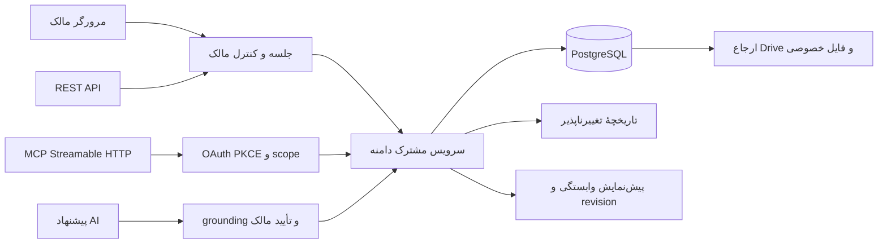

# معماری

چهار ورودی UI، REST، MCP و AI به یک سرویس دامنه می‌رسند. تنها محل نوشتن دادهٔ کاری `server/domain/service.ts` است. PostgreSQL منبع حقیقت است؛ حافظهٔ مرورگر فقط ترجمه، نمایش و cache کوتاه خواندن را نگه می‌دارد.

هر تغییر، principal معتبر، scope، شناسهٔ عملیات و برای موجودیت موجود revision دارد. تراکنش روی مالک قفل می‌گیرد؛ retry همان قصد، نتیجهٔ قبلی را برمی‌گرداند. استفادهٔ دوباره از کلید با ورودی متفاوت خطای conflict است. audit و idempotency journal در پشتیبان حفظ می‌شوند.

گراف hard prerequisites از hierarchy زیرکارها مستقل است. گروه ALL همه و گروه ANY یکی از اعضای Done را لازم دارد. Cancelled شرط را برآورده نمی‌کند. readiness از status مستقل محاسبه می‌شود. بازگشایی پیش‌نیاز روی آمادگی پایین‌دست اثر دارد و کار Done پایین‌دست را خودکار باز نمی‌کند. cycle در منطق دامنه و guard SQL کنترل می‌شود. waiver به قصد صریح انسان، دلیل و تأیید معتبر نیاز دارد.

چک‌لیست آیتم سبک داخل کار است. promotion یک بار و در یک عملیات، task مستقل ایجاد می‌کند و هویت/تاریخچهٔ آیتم حفظ می‌شود. template و recurrence شاخهٔ جدید با شناسه‌های تازه می‌سازند و لبه‌های داخلی را remap می‌کنند. پیشنهاد زمان‌بندی مهلت را خودکار جابه‌جا نمی‌کند.

Better Auth جلسات، passkey، OAuth provider و refresh را مدیریت می‌کند. MCP از cookie مرورگر احراز هویت نمی‌کند: توکن امضاشده، issuer، audience، expiry، scope، مالک و جلسهٔ لغونشده لازم است. Google social grant رمزگذاری می‌شود؛ سرور فقط تقویم را می‌خواند. iCalendar فقط HTTPS با میزبان مجاز، DNS/IP عمومی و بدون redirect خوانده می‌شود.

فایل private Blob قبل از ثبت در دامنه با اندازه و SHA-256 واقعی بررسی می‌شود. فایل Drive ارجاع اصلی است و import آن را جابه‌جا نمی‌کند. دسترسی download دوباره مالک را کنترل می‌کند. آرشیو بدون برقرار بودن قواعد ارتباط و provider معتبر، fail closed است.

مدل AI صرفاً plan تولید می‌کند. ورودی منبع untrusted است؛ شناسه‌ها باید از context واقعی بیایند و مدل نمی‌تواند scope، waiver یا approval جعل کند. هر action پس از تأیید به دامنه می‌رود و دوباره خوانده می‌شود. اجرای چند action تراکنش واحد بین همهٔ providerها نیست؛ کلید ثابت هر مرحله retry را امن می‌کند.

Vercel runtime فایل‌سیستم موقت دارد. PostgreSQL و private object storage ذخیرهٔ پایدارند. Cron روزانهٔ Hobby برای یادآورها و occurrenceهاست؛ زمان تحویل دقیق دقیقه‌ای وعده داده نمی‌شود. قطعی provider باید همراه وضعیت خطای صریح نمایش داده شود.
