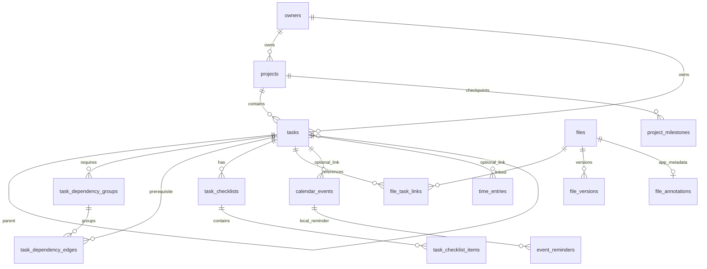

# Canonical relational data model

The production authority is PostgreSQL. `server/db/schema.ts` holds versioned SQL and `server/domain/service.ts` is the single command/query boundary for UI, HTTP, MCP and approved AI actions. Missing `DATABASE_URL` fails closed with `DATABASE_UNAVAILABLE`; PGlite exists only in isolated tests.

IDs are immutable text identifiers; source IDs retain their exact original values. Each owned relation uses a composite `(entity_id, owner_id)` foreign key so a cross-owner link cannot be inserted. Cross-project links are supported within the same owner. Tasks retain all original legacy columns, a normalized project mapping where the source explicitly named a project, plus `legacy_metadata` containing every original source attribute. Date-only deadlines remain PostgreSQL `date`; actual instants use `timestamptz` and a separate originating IANA zone.

`tasks.parent_task_id` is hierarchy. It creates no dependency or completion rule. Every task owns its status independently. Hierarchy uses transactional validation and immediate/deferred database cycle triggers, with maximum depth 12. Checklists have independent revisions and recoverable archive markers; checked items never complete a task. Promotion remaps a checklist item into exactly one real child task, stores `promoted_task_id`, and requires choosing archive or keep-reference behavior.

Dependency edges mean prerequisite → dependent. Every dependent may own multiple ALL/ANY groups, combined with top-level AND. Only active hard edges gate readiness; a prerequisite qualifies when Done and not archived, or explicitly waived with owner actor/reason/time. Cancelled never qualifies automatically. Soft links show warnings. Removing an edge archives it, preserving history. Readiness is derived in a bounded snapshot query and never stored as a workflow status.

Concurrent mutations acquire a PostgreSQL advisory transaction lock keyed by owner, then enforce expected entity revision. Graph checks also run as database triggers, protecting direct database writers. Reachability uses recursive SQL `UNION` to deduplicate visited vertices; error explanations reconstruct the actual path. Idempotency stores the complete result keyed by owner + stable request key, with an input/actor hash; changed reuse is rejected. Activity is append-only, including old/new values and provenance. Preview records are owner-bound, expire after 15 minutes and pin all affected revisions.

Files and tasks have many-to-many links with relation purpose and inactive history. Filename is never identity. Version families retain immutable individual file IDs and checksum metadata. Canonical archive eligibility requires all existing active linked tasks closed, at least one active link and an unprotected private Blob record. Google Drive originals are pointers and never moved by these domain services; their archive/restore mutations fail closed until a separately authorized move adapter exists. Reopening a linked task restores only private Blob archive state. Original Drive identifiers, parent metadata and link history remain unchanged. Canonical private file registration verifies actual provider bytes, SHA-256, size and owner namespace independently of the upload route.

Calendar events and worked time are separate entities. Local events support RFC5545 recurrence expansion through the calendar integration helper; overlap checks apply only to time entries. Calendar mutation never follows implicitly from a task deadline or status change. Reminders are durable in-app records; scheduling/delivery capability must be verified separately.

`calendar_events.recurrence_exceptions` is an owner-validated JSONB array of local dates (`YYYY-MM-DD`) or local date-times (`YYYY-MM-DDTHH:mm:ss`) in the series IANA zone. Dates exclude all occurrences that date; date-times exclude the matching local occurrence. Notes-only writes preserve the master rule, time and exceptions, and expanded DTOs expose the original master times separately. Whole-series time changes require explicit `apply_to_series` intent. Read-only analytics derives complete task/history counts and scoped time aggregates; these do not create a second persistent ledger or sample the first UI page.

A moved local occurrence is another nonrecurring `calendar_events` row, with immutable `series_event_id`, `original_occurrence_starts_at` and local `recurrence_id`. The master receives the matching exclusion in the same owner-locked transaction; its base start/end/rule are preserved. Composite owner foreign keys and a unique original-occurrence index prevent cross-owner or duplicate overrides. The self-reference is deferred so portable restore can insert events in either order. Additive idempotent migration preserves preexisting event rows. Override changes advance the master revision; whole-series deletion soft-archives its overrides with audit. Structural master edits with stored overrides require a separately reviewed replacement series; metadata and override time edits remain supported. Removing a moved exclusion is rejected to prevent duplicate appointments.

Additional normalized tables include milestones, templates, comments, tags/relations, notes/knowledge, saved views, preferences, reminders, notifications, append-only activity, idempotency results, command previews, outbox and migration batches/mappings/quarantine. Outbox is an operation journal, not a claim that external services share PostgreSQL transactions. A trusted system principal can run the daily job: due actionable in-app reminders become durable notifications once; closed/archived reminders are cancelled. Explicit owner-configured RRULE task recurrence materializes template instances with unique owner/rule/date identity, new internal task/edge/checklist IDs and no links to unrelated old occurrences. Daily catch-up is bounded to 30 instances/1,000 tasks; the next occurrence remains durable for later runs. Exact delivery time is not promised by a daily scheduler.

Migration retains raw Tasks/Files/Links/Activity/Settings/Guide snapshots inside private database metadata. Unknown fields remain intact. Existing destination edits require conflict review; orphan links are quarantined. No source narrative creates dependency edges or checklists. Backup snapshots include full graph/checklist/history, recurrence and accepted idempotency result tables and SHA-256 table/manifest checksums; restoration requires an empty isolated workspace with the same owner identity and explicit owner intent. Restored accepted operation keys remain replayable, preventing duplicate creates across restoration. JSONB scalar values are serialized according to actual database column type, preserving legacy audit values.

`file_annotations` stores owner-bound descriptions and at most 50 plain label tags separately from original file bytes, provider references, parent metadata and versions. Metadata edits guard/increment the file revision, preserve all original attributes and append audit. File queries include annotations; normalized description/tag filters precede pagination. `calendar_events.category` stores explicit owner choices for local events; moved occurrences inherit the actual original category. External events remain read-only and are not classified by guessed titles.

`event_reminders` has an owner-composite event foreign key and a separately chosen timestamp. Optional occurrence identity must be an exact live series member. Its Pending/Paused/Cancelled/Succeeded lifecycle is revision-guarded, preserves the original reminder time and cannot resend terminal reminders. Archiving a local event cancels pending and paused event reminders with audit. The system job delivers only live due occurrences and records one notification, with transactional rollback and accepted-operation replay. `notifications.target_type` defaults legacy rows to task; calendar rows and mark-read actions require calendar scope. A task-only client cannot read calendar notification content.

Reports aggregate complete owner records, explicitly disclose ranges and permission gaps and bound only their detail lists. Overdue inventory, analytics and ageing share the same date-or-expired-instant predicate without inventing a midnight for date-only deadlines. Registered file sizes are decimal byte counts, with unknown sizes separate; they do not represent provider account storage or billing. Duplicate candidates require matching stored canonical private Blob SHA-256/size/version evidence; unverified Google/external hashes are explicitly excluded. Density, nested accessibility and retention preferences are durable validated configuration; retention never triggers automatic history deletion.

Schema version remains 1 with idempotent additive DDL mirrored in `0001_initial.sql`. New exports include annotations and event reminders. Original valid v1 manifests may omit only these registered new tables and their checksums together, restored as empty arrays. Unknown table/checksum names, partial omission and unknown row columns fail closed. All row-column layouts are validated before restore table inserts. A coordinator-only explicit pre-DDL export option probes these known additions read-only and omits absent tables without changing schema; normal exports require the complete schema.

AI compound graph proposals use a server-only canonical transaction bridge. A reserved new-task identity is carried by an object capability rather than a public JSON field. Simulations validate the same commands, reads, previews and deferred constraints, then roll back every business/preview/audit/idempotency/outbox row. After owner approval, the plan receipt and all canonical steps can commit on one owner-locked connection. A current graph/checklist/template/project fingerprint invalidates stale approvals; it excludes proposal/budget and other bookkeeping rows. No new persistent tables or public domain operations are introduced by this bridge.

Public test fixtures are synthetic. Source data, private IDs, source snapshots, auth values and backups are excluded from the public repository.
