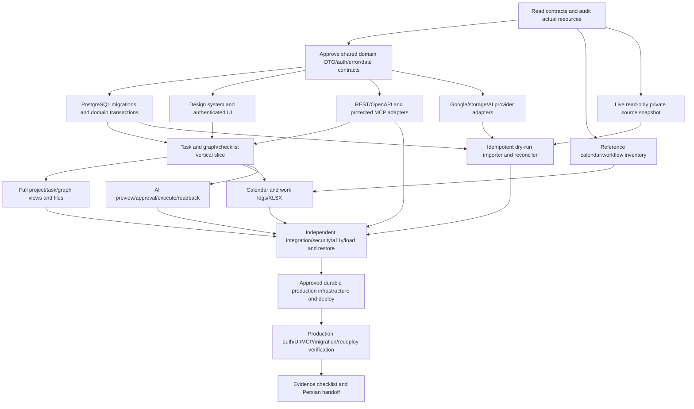

# Implementation dependency graph

This graph describes engineering dependencies; product task dependencies are separate persisted domain data. Foundation implementations are present and observed layer checks are recorded in the dependency test matrix. Release, migration cutover and externally configured providers remain independently gated.

| Node     | Current state                                  | Exit evidence                                                                                                                        |
| -------- | ---------------------------------------------- | ------------------------------------------------------------------------------------------------------------------------------------ |
| A        | Discovery completed                            | Full sanitized contract, repository/account audit and private source inventory                                                       |
| B        | Approved                                       | Shared DTOs, command/query enums, canonical auth/revision/idempotency boundary                                                       |
| R        | Review completed                               | MIT reference review; adapted pure calendar/time/export helpers and tests                                                            |
| M        | Private snapshot/rehearsal recorded            | Source audit owns private snapshot, replay/restore and reconciliation; production cutover remains separate                           |
| D/P      | Implemented; independent layer checks recorded | PostgreSQL domain, REST/OpenAPI and OAuth MCP checks in the test matrix and operator checkpoint                                      |
| V        | Authenticated baseline proof recorded          | Browser/REST/genuine OAuth MCP agree on graph/checklist state; fresh extended regression remains required                            |
| MIG      | Rehearsal checks recorded                      | Exact source replay/reconciliation/restore in isolated storage; production import/cutover remains orchestrator-gated                 |
| U/F/C    | Breadth implemented; local proof recorded      | Build-10/11 workflow and all 30 responsive main-view checks; build-12 complete repaired Dashboard/Settings/PWA/Reports PASS          |
| AI       | Independent scope review open                  | Normative action/retrieval/simulation requirements must be implemented and proved; configured provider execution remains separate    |
| I        | Adapter implementation present                 | Each provider's actual authorization/storage/model runtime must be proved independently                                              |
| Q        | In progress                                    | Meaningful tests, race/auth/restore/load and automated/manual visual evidence; unchecked or externally blocked gates remain explicit |
| DEP/LIVE | Orchestrator verification                      | Exact deployed SHA, authenticated production checks, cutover and actual redeployment persistence                                     |
| H        | In progress                                    | Evidence-based Persian user/operator handoff and current checkpoint                                                                  |

An authorization issue in one provider does not block independent nodes. Original sources remain read-only; external communications, paid resources and unsupported client privileges cannot be bypassed.
