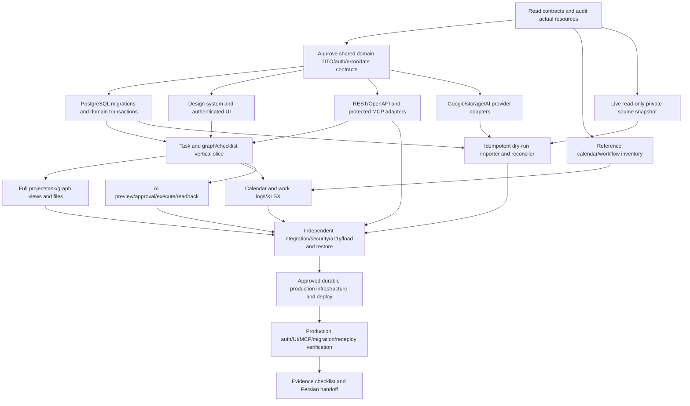

# Implementation dependency graph

Status: NOT RUN unless noted. This graph describes engineering dependencies; product task dependencies are separately persisted domain data.

| Node       | Current state | Exit evidence                                                              |
| ---------- | ------------- | -------------------------------------------------------------------------- |
| A          | ACTIVE        | Actual audit, source/repo capabilities, full requirements                  |
| B          | NOT RUN       | Shared contract approved and discoverable                                  |
| R          | ACTIVE        | Reference inventory and reuse/license/security assessment                  |
| M          | NOT RUN       | Complete private source snapshot plus freshness/aggregate report           |
| D/U/P/I    | NOT RUN       | Implementations and focused tests against approved contracts               |
| V          | NOT RUN       | Browser/REST/MCP same DB; A/B/C/D + checklists + auth/retry/conflict/cycle |
| F/C/AI/MIG | NOT RUN       | Module and source preservation tests                                       |
| Q          | NOT RUN       | Actual result matrix, vulnerability review and staging restore             |
| DEP/LIVE   | NOT RUN       | Observed production resources/URL/SHA/auth/client/readback/redeploy        |
| H          | NOT RUN       | AC-01..28 grounded in verified evidence                                    |

An authorization issue in one provider does not block independent nodes. Source mutation, external communications, paid resources and unsupported client privileges cannot be bypassed.
